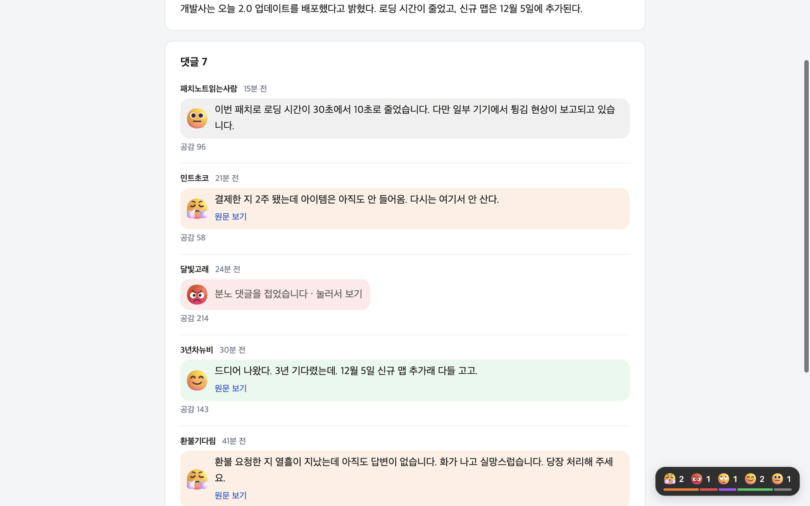

# Emotionless

댓글마다 감정을 이모티콘으로 보여 주고, 욕설과 과한 감정 표현을 걷어낸 글로 바꿔 주는 Chrome 확장 프로그램입니다. 서버와 외부 API 없이 기기 안에서만 동작합니다.

```
원문: 와 결제한 지 2주 됐는데 아이템은 아직도 안 들어옴ㅋㅋㅋ 다시는 여기서 안 산다 진짜 최악
표시: 😤 결제한 지 2주 됐는데 아이템은 아직도 안 들어옴. 다시는 여기서 안 산다.
```



## 기능

- **감정 이모티콘**: 댓글을 분노, 불만, 비난, 긍정, 슬픔, 불안, 놀람, 중립 중 하나로 분류해 이모티콘과 색으로 표시합니다.
- **표현 순화**: 욕설, ㅋㅋ·ㅠㅠ, 반복 기호, 강조어를 지웁니다. 문장을 새로 쓰지 않고 지우기만 합니다.
- **댓글 접기**: 분노·비난 댓글은 한 줄로 접어 두고, 누르면 펼칩니다.
- **원문 보기**: 순화본과 원문을 오갈 수 있습니다.
- **반응 요약**: 지금까지 본 댓글의 감정 분포를 화면 구석에 표시합니다.
- **댓글 직접 지정**: 자동으로 찾지 못한 사이트에서는 댓글 하나를 클릭해 위치를 알려 줄 수 있습니다.

한국어 댓글만 처리합니다.

## 동작 방식

1. 콘텐츠 스크립트가 페이지에서 댓글 목록을 찾습니다. 같은 모양으로 반복되는 블록과 `comment`, `reply`, `댓글` 같은 이름 단서를 함께 봅니다.
2. 화면에 보이는(곧 보일) 댓글만 분류를 요청합니다.
3. 오프스크린 문서에서 [KOTE](https://huggingface.co/searle-j/kote_for_easygoing_people) 감정 분류 모델을 Transformers.js(WebAssembly)로 실행합니다. 44개 감정 라벨을 8개 그룹으로 묶습니다.
4. 규칙으로 감정 표현을 지운 글을 만들고, 원문 요소는 숨긴 채 옆에 순화본을 붙입니다.

생성형 모델로 문장을 다시 쓰는 방식도 시험했지만 댓글당 수 초가 걸려 쓰지 않았습니다. 그 과정은 `experiments/` 에 남아 있습니다.

## 판정 고치기와 피드백 서버

판정이 틀렸을 때 사용자가 직접 고칠 수 있습니다.

- 댓글의 얼굴을 누르면 맞는 감정을 고를 수 있습니다.
- 댓글 글을 드래그하면 그 표현을 지우거나 남기도록 지정할 수 있습니다.

고친 내용은 기기에 저장되어 바로 적용됩니다. 분류 모델이 낸 점수가 비슷한 다른 댓글에도 같은 감정을 적용합니다(`extension/src/shared/learn.js`).

선택 기능으로, 사용자가 동의하면 고친 내용을 피드백 서버로 보냅니다. 서버는 여러 사용자가 같은 의견을 낸 것만 검토를 거쳐 공개하고, 모든 사용자의 확장이 그것을 받아 판정에 반영합니다. 서버 주소를 `extension/config.json` 의 `apiBase` 에 적고 빌드하면 켜지고, 비워 두면 확장은 서버와 통신하지 않습니다. 서버는 별도의 비공개 저장소에서 관리합니다.

## 빌드

Node.js 22 이상과 [uv](https://docs.astral.sh/uv/)가 필요합니다.

```bash
cd extension
npm install
./scripts/prepare-model.sh   # 모델을 내려받아 변환 (처음 한 번, 수 분 소요)
npm run build                # dist/ 생성
```

`chrome://extensions` 에서 개발자 모드를 켜고 "압축해제된 확장 프로그램을 로드합니다"로 `extension/dist` 폴더를 선택합니다.

```bash
npm test          # 순화 규칙과 감정 묶음 로직 테스트
npm run package   # 스토어 제출용 압축 파일을 store/ 에 생성
```

`test/fixtures/` 에 수동 확인용 댓글 페이지가 있습니다.

## 폴더 구조

| 경로 | 내용 |
|---|---|
| `extension/src/content/` | 댓글 감지, 화면 표시 |
| `extension/src/shared/` | 순화 규칙(`strip.js`), 감정 묶음(`emotion.js`) |
| `extension/src/offscreen.js` | 모델 실행 |
| `extension/static/` | 매니페스트, 스타일, 팝업, 이모티콘 그림 |
| `extension/store/` | 스토어 등록 문구, 이미지, 개인정보처리방침 |
| `docs/` | 개인정보처리방침과 지원 페이지 (GitHub Pages) |
| `experiments/` | 모델 비교 실험 |

## 알려진 한계

- 감정 묶음 기준은 소수의 예문으로 잡은 초기값이라 틀리는 경우가 있습니다. 비꼬는 말을 긍정으로 보기도 합니다.
- 사이트 구조에 따라 댓글을 찾지 못하거나 다른 영역을 댓글로 잘못 볼 수 있습니다.
- 모델이 포함되어 설치 용량이 약 150MB입니다.

## 개인정보

어떤 데이터도 기기 밖으로 보내지 않습니다. 자세한 내용은 [개인정보처리방침](docs/privacy.html)을 참고하세요.

## 사용한 오픈소스

KOTE 감정 분류 모델(MIT), Transformers.js(Apache-2.0), ONNX Runtime Web(MIT), Fluent Emoji(MIT). 자세한 내용은 [`extension/THIRD_PARTY_NOTICES.md`](extension/THIRD_PARTY_NOTICES.md)에 있습니다.
